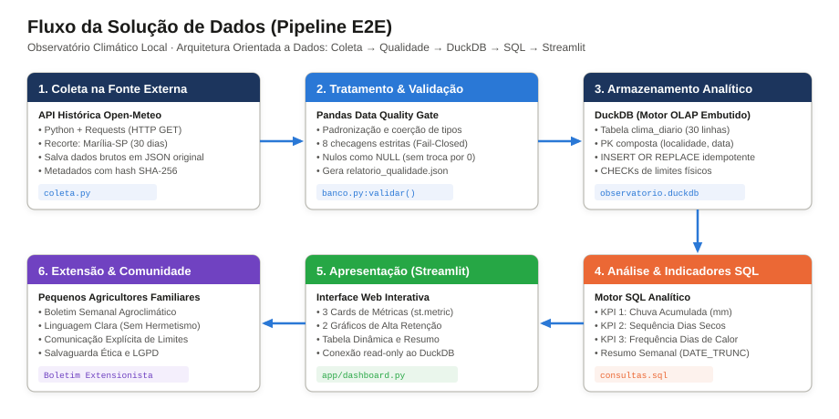
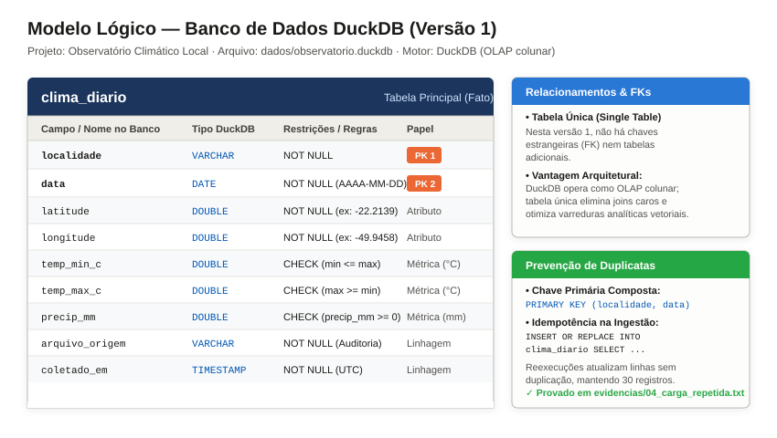
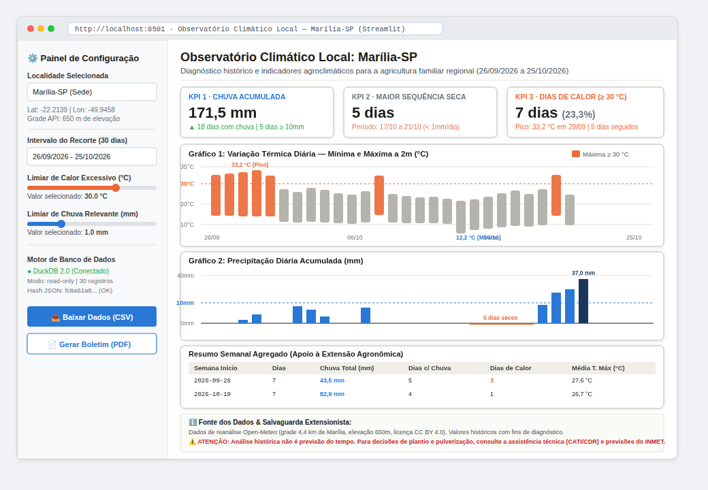

# Observatório Climático Local: Marília-SP

**Projeto Integrador Extensionista II · Curso de Bacharelado em Ciência de Dados**  
**Universidade de Marília (Unimar)**  
**Aluno:** Fernando da Conceição Cordeiro Filho · **Professora:** Vangela Tatiana Madalena Banhos  
**Repositório:** [SAGIEV007/observatorio-climatico-local](https://github.com/SAGIEV007/observatorio-climatico-local)

---

## Relatórios e Documentos das Etapas

| Etapa | Tema | Relatório em PDF | Documentação Completa |
|---|---|---|---|
| **AE2** | Coleta, tratamento, carga no DuckDB e análise inicial | [docs/escopo-1/AE2](docs/escopo-1/AE2/Relatorio_AE2_Observatorio_Climatico_Local.pdf) | Execuções e evidências registradas em `evidencias/` |
| **AE2-2** | Desenho da solução de dados — pré-implementação | [docs/escopo-1/AE2-2](docs/escopo-1/AE2-2/Relatorio_AE2-2_Observatorio_Climatico_Local.pdf) | [Relatório Completo em Markdown](docs/escopo-1/AE2-2/Relatorio_AE2-2_Observatorio_Climatico_Local.md) · [Roadmap de Issues](docs/escopo-1/AE2-2/ISSUES.md) |

---

## 1. Objetivo e Público-Alvo

Transformar dados meteorológicos públicos em indicadores simples e retrospectivos sobre chuva e temperatura, apoiando **pequenos agricultores familiares da região de Marília-SP** e os técnicos extensionistas da Casa da Agricultura (CATI/CDRS) que os orientam.

O projeto adota uma abordagem estritamente histórica e descritiva: **olha para o que já aconteceu nos últimos 30 dias para apoiar o aprendizado e a tomada de decisão no manejo da terra, sem fazer previsão do tempo.**

---

## 2. Recorte do Projeto

| Item | Especificação |
|---|---|
| **Fonte** | [API histórica da Open-Meteo](https://open-meteo.com/en/docs/historical-weather-api) (`/v1/archive`), modelo padrão "Best match" (reanálise ERA5/IFS) |
| **Localidade** | Marília-SP, coordenadas de referência: latitude `-22.2139` e longitude `-49.9458` (Datum WGS84). Grade da API: `-22.2496, -49.9277`, elevação 650 m (~4,4 km da sede) |
| **Período** | **26/09/2026 a 25/10/2026** (rigorosamente 30 dias consecutivos), fuso horário `America/Sao_Paulo` |
| **Variáveis** | Temperatura mínima diária (`temp_min_c`), temperatura máxima diária (`temp_max_c`) e precipitação diária acumulada (`precip_mm`) |
| **Banco** | DuckDB (tabela única `clima_diario` em `dados/observatorio.duckdb`) |

---

## 3. Desenho da Solução de Dados (Arquitetura E2E)

A arquitetura do Observatório Climático Local organiza-se em um pipeline modular, determinístico e auditável de 6 camadas:

1. **Coleta e Ingestão (`coleta.py`):** Consumo da API Open-Meteo via `requests`, com retry exponencial e preservação estrita do arquivo bruto original (`dados/originais/*.json`) acompanhado de metadados com hash SHA-256 (`*.meta.json`).
2. **Tratamento e Qualidade (`banco.py`):** Padronização de colunas, coerção de tipos via `pandas` e execução do *Data Quality Gate* com 8 checagens formais sob diretriz *fail-closed*. Gera `relatorio_qualidade.json`.
3. **Armazenamento Analítico (`banco.py`):** Ingestão no DuckDB na tabela `clima_diario` com chave primária composta `(localidade, data)` e restrições `CHECK`, aplicando carga idempotente (`INSERT OR REPLACE`).
4. **Camada Analítica SQL (`consultas.sql`):** Consultas otimizadas para conferência de integridade e cálculo dos 3 KPIs principais e do resumo semanal.
5. **Apresentação e Visualização (`app/dashboard_prototipo.py`):** Interface web interativa em Streamlit conectada em modo somente leitura ao DuckDB, com cards de métricas, gráficos temporais e tabela interativa.
6. **Comunicação Extensionista:** Geração do Boletim Agroclimático Semanal em linguagem desmistificada, com comunicação explícita de limitações e conformidade com a LGPD.

Diagramas arquiteturais disponíveis:
- [Fluxo da Solução (Pipeline E2E)](docs/escopo-1/AE2-2/diagramas/fluxo_solucao_arquitetura.svg)
- [Modelo Lógico do DuckDB](docs/escopo-1/AE2-2/diagramas/modelo_logico_duckdb.svg)
- [Wireframe do Dashboard Streamlit](docs/escopo-1/AE2-2/wireframes/wireframe_streamlit_dashboard.svg)



---

## 4. Dicionário de Dados e Modelo Lógico (DuckDB)

### Tabela Principal: `clima_diario`

```sql
CREATE TABLE IF NOT EXISTS clima_diario (
    localidade      VARCHAR   NOT NULL,
    data            DATE      NOT NULL,
    latitude        DOUBLE    NOT NULL,
    longitude       DOUBLE    NOT NULL,
    temp_min_c      DOUBLE,
    temp_max_c      DOUBLE,
    precip_mm       DOUBLE    CHECK (precip_mm >= 0),
    arquivo_origem  VARCHAR   NOT NULL,
    coletado_em     TIMESTAMP NOT NULL,
    PRIMARY KEY (localidade, data),
    CHECK (temp_min_c <= temp_max_c)
);
```

| Campo | Tipo DuckDB | Descrição e Unidade | Origem | Regra de Preenchimento / Validação |
|---|---|---|---|---|
| `localidade` | `VARCHAR` | Município e UF de referência ("Marília-SP") | Configuração | **NOT NULL.** PK composta. Formato `[Cidade]-[UF]`. |
| `data` | `DATE` | Data civil do registro (AAAA-MM-DD) | API (`time`) | **NOT NULL.** PK composta. 30 dias contínuos, sem duplicatas. |
| `latitude` | `DOUBLE` | Latitude da sede municipal (-22.2139) | Configuração | **NOT NULL.** Faixa [-90.0, 90.0]. |
| `longitude` | `DOUBLE` | Longitude da sede municipal (-49.9458) | Configuração | **NOT NULL.** Faixa [-180.0, 180.0]. |
| `temp_min_c` | `DOUBLE` | Temperatura mínima do ar a 2m (°C) | API (`temp_min`) | Faixa [-5, 45] °C. `min <= max`. Nulos como NULL (mínimo 90% cobertura). |
| `temp_max_c` | `DOUBLE` | Temperatura máxima do ar a 2m (°C) | API (`temp_max`) | Faixa [-5, 45] °C. `max >= min`. Nulos como NULL (mínimo 90% cobertura). |
| `precip_mm` | `DOUBLE` | Precipitação diária acumulada (mm) | API (`precip_sum`) | **CHECK (precip_mm >= 0).** Faixa [0, 400] mm. Nulos como NULL (mínimo 90% cobertura). |
| `arquivo_origem` | `VARCHAR` | Nome do JSON bruto de origem | Metadados | **NOT NULL.** Auditoria e rastreabilidade (*data lineage*). |
| `coletado_em` | `TIMESTAMP` | Timestamp da requisição à API (UTC) | Metadados | **NOT NULL.** Padrão ISO 8601. |

**Relacionamentos e Chaves Estrangeiras:** Nesta versão 1, **não existem chaves estrangeiras nem tabelas secundárias**. A modelagem dimensional em tabela única é a melhor prática para o motor analítico colunar DuckDB, dispensando *joins* dispendiosos e viabilizando varreduras sub-segundo no Streamlit.

**Prevenção de Duplicatas:** A chave primária `(localidade, data)` combinada com a cláusula `INSERT OR REPLACE` garante idempotência rigorosa em reexecuções.



---

## 5. Plano de Qualidade dos Dados (8 Checagens Formais)

| Checagem | Campo(s) | Regra ou Teste | Ação em Caso de Falha |
|---|---|---|---|
| **1. Completude temporal** | `data` | Exatamente 30 dias contínuos no intervalo: `len(datas) == 30` | **Interrompe (ERRO).** Aborta a carga no DuckDB. |
| **2. Unicidade de datas (PK)** | `localidade`, `data` | Ausência de duplicatas: `datas.duplicated().sum() == 0` | **Interrompe (ERRO).** Bloqueia ingestão duplicada. |
| **3. Consistência física térmica** | `temp_min_c`, `temp_max_c` | Mínima menor ou igual à máxima: `(min > max).sum() == 0` | **Interrompe (ERRO).** Rejeita inconsistência termodinâmica. |
| **4. Não-negatividade da chuva** | `precip_mm` | Chuva não-negativa: `(precip_mm < 0).sum() == 0` | **Interrompe (ERRO).** Chuva negativa é violação física. |
| **5. Plausibilidade térmica** | `temp_min_c`, `temp_max_c` | Valores entre -5 °C e 45 °C | **AVISO** se > 40 °C; **ERRO** se extrapolar extremos. |
| **6. Plausibilidade pluviométrica** | `precip_mm` | Chuva diária entre 0 mm e 400 mm | **Interrompe (ERRO)** se > 400 mm (recorde histórico em SP). |
| **7. Cobertura e ausentes** | Todas as métricas | Cobertura de dados válidos ≥ 90% | Se ≥ 90%, **mantém como NULL**; se < 90%, **interrompe (ERRO)**. |
| **8. Integridade criptográfica** | Arquivo JSON bruto | `hashlib.sha256(arquivo) == metadados["sha256"]` | **Interrompe (ERRO).** Detecta adulteração ou corrupção. |

---

## 6. Resultados Analíticos e Indicadores (KPIs)

| Indicador | Consulta SQL | Resultado Real (Marília-SP) | Interpretação Agronômica |
|---|---|---|---|
| **KPI 1: Chuva Acumulada** | `SUM(precip_mm)` | **171,5 mm** (em 18 dias com chuva) | Aporte hídrico volumoso, porém concentrado: 62,6% da chuva caiu em apenas 5 dias com precipitação ≥ 10 mm, e 48,3% nos últimos 4 dias (22 a 25/10). Risco de erosão e lixiviação de nutrientes. |
| **KPI 2: Maior Sequência Seca** | Agrupamento de dias com `< 1 mm` | **5 dias consecutivos** (17/10 a 21/10) | Ausência de veranico severo no período. Coincidiu com temperaturas máximas em elevação (24,9 a 29,7 °C), encerrando-se com a chuva de 22/10. |
| **KPI 3: Dias de Calor (≥ 30 °C)** | `COUNT(*) FILTER (WHERE temp_max_c >= 30)` | **7 dias** (23,3% do período) | Cinco dos 7 dias ocorreram consecutivamente no fim de setembro (26 a 30/09), atingindo a máxima de 33,2 °C em 29/09, com amplitude térmica média de 9,2 °C. Período crítico de exigência de irrigação e sombreamento. |

---

## 7. Wireframe do Dashboard Streamlit

O wireframe da interface interativa Streamlit organiza os dados em cards executivos, gráficos analíticos sincronizados e tabela completa, priorizando clareza em computadores e celulares:



Um protótipo executável do painel está disponível em [`app/dashboard_prototipo.py`](app/dashboard_prototipo.py).

---

## 8. Roadmap de Implementação Futura (Issues Técnicas)

O desenvolvimento futuro está estruturado em 6 issues formais, detalhadas em [`docs/escopo-1/AE2-2/issues/`](docs/escopo-1/AE2-2/issues/) e consolidadas em [`docs/escopo-1/AE2-2/ISSUES.md`](docs/escopo-1/AE2-2/ISSUES.md):

1. [Issue #01: Pipeline de Coleta Automatizada e Preservação de Dados Brutos](docs/escopo-1/AE2-2/issues/01_pipeline_coleta_open_meteo.md)
2. [Issue #02: Módulo de Tratamento, Padronização e Validação de Qualidade](docs/escopo-1/AE2-2/issues/02_validador_qualidade_pandas.md)
3. [Issue #03: Camada de Persistência e Armazenamento Analítico Idempotente](docs/escopo-1/AE2-2/issues/03_armazenamento_duckdb_idempotente.md)
4. [Issue #04: Motor de Consultas Analíticas e Cálculo de Indicadores/KPIs](docs/escopo-1/AE2-2/issues/04_consultas_sql_indicadores_kpi.md)
5. [Issue #05: Desenvolvimento do Dashboard Interativo de Visualização](docs/escopo-1/AE2-2/issues/05_dashboard_interativo_streamlit.md)
6. [Issue #06: Módulo de Comunicação Extensionista, Boletins Agronômicos e Acessibilidade](docs/escopo-1/AE2-2/issues/06_comunicacao_extensionista_boletim.md)

---

## 9. Estrutura Completa de Diretórios

```text
observatorio-climatico-local/
├── .github/
│   └── ISSUE_TEMPLATE/
│       ├── config.yml                                        # Configuração de issues
│       └── tarefa-implementacao.md                           # Template padronizado de tarefa
├── app/
│   └── dashboard_prototipo.py                                # Protótipo executável em Streamlit
├── dados/
│   ├── originais/
│   │   ├── open_meteo_marilia-sp_2026-09-26_2026-10-25.json      # Resposta bruta original da API
│   │   └── open_meteo_marilia-sp_2026-09-26_2026-10-25.meta.json # Metadados com hash SHA-256
│   ├── tratados/
│   │   ├── clima_diario.csv                                  # Tabela tratada intermediária
│   │   └── relatorio_qualidade.json                          # Relatório de auditoria de qualidade
│   └── observatorio.duckdb                                   # Banco colunar DuckDB (clima_diario)
├── docs/
│   └── escopo-1/
│       ├── AE2/
│       │   └── Relatorio_AE2_Observatorio_Climatico_Local.pdf  # Relatório da etapa anterior
│       └── AE2-2/
│           ├── Relatorio_AE2-2_Observatorio_Climatico_Local.pdf # Relatório técnico formal da AE2-2 (PDF)
│           ├── Relatorio_AE2-2_Observatorio_Climatico_Local.md  # Relatório completo em Markdown
│           ├── ISSUES.md                                     # Matriz consolidada de issues
│           ├── diagramas/
│           │   ├── modelo_logico_duckdb.svg                  # Diagrama vetorial da tabela DuckDB
│           │   └── fluxo_solucao_arquitetura.svg             # Diagrama vetorial do pipeline E2E
│           ├── wireframes/
│           │   ├── wireframe_streamlit_dashboard.svg         # Wireframe vetorial do Streamlit
│           │   └── wireframe_streamlit_dashboard.png         # Imagem de alta resolução do wireframe
│           └── issues/                                       # 6 issues detalhadas de implementação
│               ├── 01_pipeline_coleta_open_meteo.md
│               ├── 02_validador_qualidade_pandas.md
│               ├── 03_armazenamento_duckdb_idempotente.md
│               ├── 04_consultas_sql_indicadores_kpi.md
│               ├── 05_dashboard_interativo_streamlit.md
│               └── 06_comunicacao_extensionista_boletim.md
├── evidencias/                                               # Logs e saídas reais de execução
├── testes/                                                   # Testes unitários automatizados (19 testes)
├── banco.py                                                  # Módulo de validação, qualidade e carga DuckDB
├── coleta.py                                                 # Ingestão da API com preservação de JSON bruto
├── config.py                                                 # Configuração do recorte e caminhos
├── consultas.sql                                             # Consultas analíticas SQL
├── executar_consultas.py                                     # Executor de consultas SQL
├── comparar_fontes.py                                        # Análise de sensibilidade de modelos
├── requirements.txt                                          # Dependências com versões travadas
└── README.md                                                 # Documentação mestre do projeto
```

---

## 10. Preparação do Ambiente e Execução

### Pré-requisitos
Python 3.11 ou mais recente.

```bash
git clone https://github.com/SAGIEV007/observatorio-climatico-local.git
cd observatorio-climatico-local
python -m venv .venv
source .venv/bin/activate        # Windows: .venv\Scripts\activate
pip install -r requirements.txt
```

### Comandos de Execução

```bash
python coleta.py                 # 1. Ingestão da API e preservação do JSON bruto
python banco.py                  # 2. Tratamento, validação e carga no DuckDB
python executar_consultas.py     # 3. Execução das consultas analíticas SQL
python -m unittest discover -s testes   # 4. Execução dos testes automatizados (19 testes)
```

Para executar o protótipo do painel interativo (opcional):
```bash
pip install streamlit
streamlit run app/dashboard_prototipo.py
```

---

## 11. Limitações e Cuidados Éticos

- **Dados de Reanálise por Grade:** Os valores derivam do modelo padrão da Open-Meteo para uma célula de grade (~4,4 km de distância da sede de Marília), em cota de 650 m. A chuva real em propriedades agrícolas específicas pode apresentar variações locais.
- **Sensibilidade de Modelos:** No teste comparativo (`evidencias/06_comparacao_de_fontes.txt`), o modelo `era5_seamless` apontou 149,2 mm contra 171,5 mm do modelo padrão (diferença de 13%), reforçando que os números devem ser lidos como ordens de grandeza referencial.
- **Análise Histórica não é Previsão:** O observatório descreve estritamente o passado recente (26/09 a 25/10/2026). Decisões de plantio futuro exigem acompanhamento de previsões operacionais em tempo real (INMET/CIIAGRO) e orientação de engenheiros agrônomos da CATI/CDRS.
- **Privacidade e LGPD:** A base utiliza exclusivamente dados meteorológicos abertos. Registros comunitários em etapas futuras observarão consentimento e anonimização (Lei 13.709/2018), permanecendo em `dados/comunidade/` fora do controle de versão.

---

## 12. Licença e Atribuição dos Dados

- Dados meteorológicos: [Weather data by Open-Meteo.com](https://open-meteo.com/), licença [CC BY 4.0](https://creativecommons.org/licenses/by/4.0/). Generated using Copernicus Climate Change Service information.
- Código e documentação: Projeto Acadêmico sob autoria de Fernando da Conceição Cordeiro Filho, Unimar 2026.
