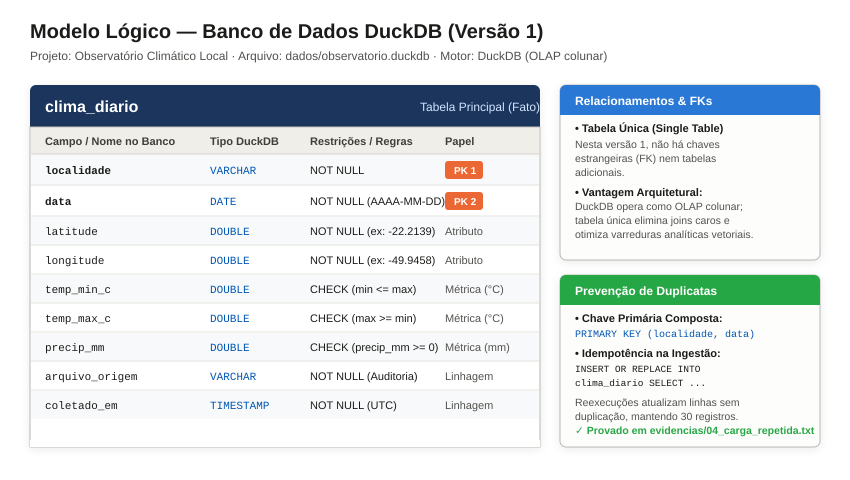
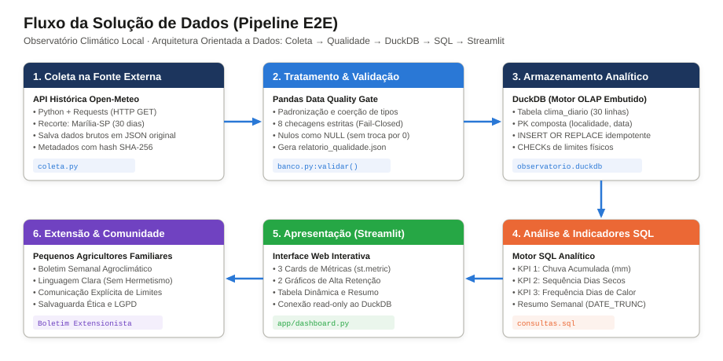
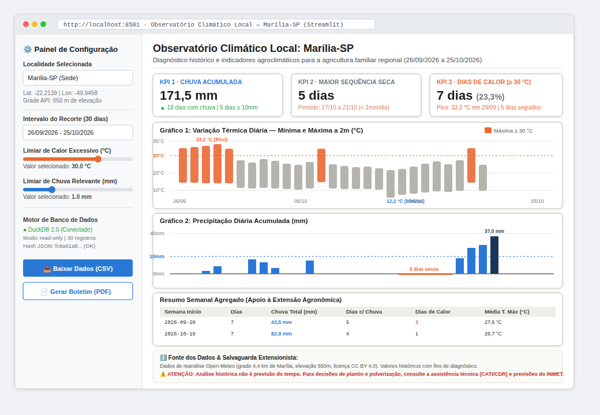

# Atividade de Estudo 2 (AE2-2): Desenho da Solução de Dados do Observatório Climático Local — Pré-Implementação

**Universidade de Marília (Unimar)**  
**Curso:** Bacharelado em Ciência de Dados  
**Disciplina:** Projeto Integrador Extensionista II  
**Aluno:** Fernando da Conceição Cordeiro Filho  
**Professora:** Vangela Tatiana Madalena Banhos  
**Data:** Novembro de 2026  
**Repositório GitHub:** [SAGIEV007/observatorio-climatico-local](https://github.com/SAGIEV007/observatorio-climatico-local)

---

## 1. Contextualização e Alinhamento com a AE1

### 1.1. Problema Local e Justificativa Extensionista
Na agricultura familiar da região de Marília-SP, decisões operacionais de manejo — como a definição da janela de semeadura, turnos de irrigação complementar, preparo de canteiros para hortaliças e proteção fitossanitária — dependem diretamente da dinâmica de precipitação e temperatura do ar. Embora o poder público e agências internacionais disponibilizem bases meteorológicas robustas, esses dados chegam em formatos técnicos complexos (grades de reanálise atmosférica, arquivos NetCDF/GRIB, APIs REST especializadas), sem tratamento local e desprovidos de tradução para a realidade prática dos produtores rurais.

O **Observatório Climático Local — Marília-SP** foi concebido como uma ponte extensionista entre a ciência de dados e a comunidade agrícola, transformando registros brutos em diagnósticos históricos compreensíveis, acessíveis e tecnicamente auditáveis. O projeto adota uma postura estritamente retrospectiva: **olha para o que já aconteceu para apoiar o aprendizado do produtor sobre o comportamento recente do clima local, sem fazer previsão do tempo.**

### 1.2. Público Beneficiário
- **Público Primário:** Pequenos agricultores familiares e cooperados da microrregião de Marília-SP, em especial produtores de olericultura, cafeicultura e fruticultura de base familiar.
- **Público Técnico Apoiador:** Técnicos extensionistas da Casa da Agricultura (CATI/CDRS - Secretaria de Agricultura e Abastecimento de SP), agrônomos de cooperativas locais e lideranças comunitárias rurais que atuam na orientação agronômica em campo.

### 1.3. Recorte Espaço-Temporal e Variáveis Homologadas
- **Localidade:** Município de Marília-SP, identificado formalmente pelas coordenadas geográficas do centro municipal: **Latitude -22,2139** e **Longitude -49,9458** (Datum WGS84). A grade meteorológica do modelo reanalisado pela API situa-se na latitude -22,2496 e longitude -49,9277 (cerca de 4,4 km da sede), em cota altimétrica de 650 metros.
- **Período de Análise:** **26 de setembro de 2026 a 25 de outubro de 2026**, totalizando rigorosamente **30 dias civis consecutivos**, no fuso horário local `America/Sao_Paulo`. O recorte captura a transição crítica entre o final da estação seca de inverno e o início das precipitações convectivas da primavera.
- **Variáveis Meteorológicas:**
  1. `temp_min_c`: Temperatura mínima diária do ar a 2 metros de altura (°C).
  2. `temp_max_c`: Temperatura máxima diária do ar a 2 metros de altura (°C).
  3. `precip_mm`: Precipitação pluviométrica diária acumulada (mm).

### 1.4. Registro de Alterações e Alinhamento com a AE1
Em relação ao planejamento delineado na AE1, a solução mantém total coerência no recorte territorial, temporal e temático. Formaliza-se como evolução o refinamento dos limiares analíticos segundo padrões internacionais de climatologia:
1. **Adoção do limiar de 1,0 mm para "dia chuvoso":** Alinhado às recomendações do *Expert Team on Climate Change Detection and Indices* (ETCCDI), separando orvalho e chuvas residuais (0,2 a 0,7 mm) de precipitações com real relevância agronômica para recarga hídrica superficial.
2. **Adoção do limiar de 30,0 °C para "dia de calor excessivo":** Baseado no índice climatológico $TXge30$ do consórcio *Climpact*, servindo como triagem inicial de estresse fisiológico de plantas na região de Marília-SP.
3. **Persistência em Tabela Única (Single Table):** Em vez de normalizar dados municipais fixos em tabelas secundárias, consolidou-se a modelagem dimensional em tabela única (`clima_diario`), ideal para a arquitetura colunar analítica (OLAP) do DuckDB.

---

## 2. Dicionário de Dados — Versão 1

A tabela principal do banco DuckDB é denominada `clima_diario`. Cada linha representa a observação meteorológica diária consolidada para uma localidade específica em uma data civil.

| Campo | Tipo Esperado | Descrição e Unidade | Origem | Regra de Preenchimento e Validação |
|---|---|---|---|---|
| `localidade` | `VARCHAR` | Identificação nominal padronizada do município e UF objeto da observação. Ex: `"Marília-SP"`. | Configuração estática do projeto (`config.LOCALIDADE`). | **Obrigatório (`NOT NULL`).** String não vazia; formato padronizado `[Município]-[UF]`. Componente da Chave Primária Composta. |
| `data` | `DATE` | Data civil do registro meteorológico diário no fuso horário local (`America/Sao_Paulo`), no formato `AAAA-MM-DD`. | Campo `time` do bloco `daily` retornado pela API Open-Meteo. | **Obrigatório (`NOT NULL`).** Data válida no padrão ISO 8601. Sem duplicatas no recorte. Deve pertencer ao intervalo contínuo de 30 dias (`2026-09-26` a `2026-10-25`). Componente da Chave Primária Composta. |
| `latitude` | `DOUBLE` | Coordenada geográfica de latitude solicitada à API para a sede municipal, em graus decimais (Datum WGS84). | Configuração do projeto (`config.LATITUDE` = -22.2139). | **Obrigatório (`NOT NULL`).** Valor numérico de ponto flutuante contido no intervalo físico válido `[-90.0, 90.0]`. |
| `longitude` | `DOUBLE` | Coordenada geográfica de longitude solicitada à API para a sede municipal, em graus decimais (Datum WGS84). | Configuração do projeto (`config.LONGITUDE` = -49.9458). | **Obrigatório (`NOT NULL`).** Valor numérico de ponto flutuante contido no intervalo físico válido `[-180.0, 180.0]`. |
| `temp_min_c` | `DOUBLE` | Menor temperatura do ar observada/estimada a 2 metros de altura nas 24 horas do dia civil, expressa em graus Celsius (°C). | Campo `temperature_2m_min` da API Open-Meteo. | Numérico ponto flutuante. Faixa física regional plausível: `[-5.0, 45.0] °C`. Deve satisfazer a restrição relacional de consistência: `temp_min_c <= temp_max_c`. Admite nulo (`NULL`) em falhas da fonte, com cobertura mínima exigida de 90%. Proibida a substituição artificial de nulo por zero. |
| `temp_max_c` | `DOUBLE` | Maior temperatura do ar observada/estimada a 2 metros de altura nas 24 horas do dia civil, expressa em graus Celsius (°C). | Campo `temperature_2m_max` da API Open-Meteo. | Numérico ponto flutuante. Faixa física regional plausível: `[-5.0, 45.0] °C`. Deve satisfazer a restrição relacional: `temp_max_c >= temp_min_c`. Admite nulo (`NULL`) em falhas da fonte; cobertura mínima de 90%. |
| `precip_mm` | `DOUBLE` | Volume total de precipitação pluviométrica acumulado ao longo das 24 horas do dia civil, medido em milímetros de lâmina d'água (mm). | Campo `precipitation_sum` da API Open-Meteo. | Numérico ponto flutuante. **Restrição de domínio:** `CHECK (precip_mm >= 0)`. Faixa plausível para o estado de SP: `[0.0, 400.0] mm`. Admite nulo (`NULL`) em falhas da fonte (nunca imputar 0 em dado ausente); cobertura mínima de 90%. |
| `arquivo_origem` | `VARCHAR` | Nome do arquivo bruto original em formato JSON preservado em disco (`dados/originais/`) do qual o dado foi extraído. | Metadados da coleta (`config.ARQUIVO_ORIGINAL.name`). | **Obrigatório (`NOT NULL`).** Garante linhagem de dados (*data lineage*) e auditabilidade científica em caso de revisão. |
| `coletado_em` | `TIMESTAMP` | Carimbo de data e hora exatas da extração na API externa com confirmação HTTP 200, gravado no padrão UTC. | Metadados da coleta (`coletado_em_utc`). | **Obrigatório (`NOT NULL`).** Timestamp válido no padrão ISO 8601, não nulo. |

---

## 3. Modelo Lógico — Versão 1

### 3.1. Estrutura Tabular do Banco DuckDB
O banco de dados do projeto é armazenado no arquivo colunar `dados/observatorio.duckdb`. A modelagem é composta pela tabela única de fatos climáticos `clima_diario`:

```sql
CREATE TABLE IF NOT EXISTS clima_diario (
    localidade      VARCHAR   NOT NULL,
    data            DATE      NOT NULL,
    latitude        DOUBLE    NOT NULL,
    longitude       DOUBLE    NOT NULL,
    temp_min_c      DOUBLE,
    temp_max_c      DOUBLE,
    precip_mm       DOUBLE    CHECK (precip_mm >= 0),
    arquivo_origem  VARCHAR   NOT NULL,
    coletado_em     TIMESTAMP NOT NULL,
    PRIMARY KEY (localidade, data),
    CHECK (temp_min_c <= temp_max_c)
);
```

#### Identificação dos Elementos do Modelo Lógico:
- **Nome da Tabela Principal:** `clima_diario`.
- **Chave Primária (PK):** Chave primária composta `PRIMARY KEY (localidade, data)`. Garante que para uma dada localidade (ex: `"Marília-SP"`) não possa haver mais de um registro para a mesma data civil.
- **Campos Obrigatórios (`NOT NULL`):** `localidade`, `data`, `latitude`, `longitude`, `arquivo_origem` e `coletado_em`. As variáveis meteorológicas admitem `NULL` em conformidade com as regras de qualidade, preservando lacunas sem contaminação estatística.
- **Chaves Estrangeiras (FK) e Relacionamentos:** **Não existem chaves estrangeiras nem tabelas secundárias nesta versão 1.**  
  *Justificativa Arquitetural:* O DuckDB é um motor de processamento analítico colunar (OLAP). Para uma série temporal de 30 dias com granularidade diária, a desnormalização controlada em tabela única elimina o custo computacional de operações de `JOIN`, simplifica a distribuição do arquivo do banco e maximiza a velocidade de varreduras vetoriais em consultas analíticas e agregações em Streamlit.
- **Regra que Impede Registros Duplicados:** A integridade contra duplicatas é assegurada em duas camadas complementares:
  1. *Na camada de ingestão Python (Pandas):* O validador executa a checagem `datas.duplicated().sum() == 0` antes de iniciar a transação no banco.
  2. *Na camada do Banco de Dados (DuckDB):* Aplicação da restrição `PRIMARY KEY (localidade, data)` combinada com a instrução de inserção idempotente:
     ```sql
     INSERT OR REPLACE INTO clima_diario
         (localidade, data, latitude, longitude, temp_min_c, temp_max_c, precip_mm, arquivo_origem, coletado_em)
     SELECT localidade, CAST(data AS DATE), latitude, longitude, temp_min_c, temp_max_c, precip_mm, arquivo_origem, coletado_em
     FROM tratados;
     ```
     Caso a mesma combinação `(localidade, data)` seja submetida novamente, a linha existente é substituída em vez de gerar duplicação de registros. O número final de registros permanece rigorosamente travado em 30 linhas.

#### Diagrama Vetorial do Modelo Lógico (DuckDB)


### 3.2. Fluxo Simples da Solução (Pipeline E2E)
O pipeline da solução é estritamente determinístico, linear e auditável, estruturado em 6 etapas:

```text
[ 1. Coleta na API Open-Meteo ]  --> Requests / HTTP GET (start_date=2026-09-26, end_date=2026-10-25)
            │                        Grava dados/originais/*.json e *.meta.json (com SHA-256)
            ▼
[ 2. Tratamento e Padronização ] --> Pandas: normalização de nomes, coerção de tipos para DATE e float64
            │                        Grava intermediário dados/tratados/clima_diario.csv
            ▼
[ 3. Quality Gate (Fail-Closed)] --> 8 checagens formais: se houver ERRO, aborta a carga no banco
            │                        Grava relatório de auditoria dados/tratados/relatorio_qualidade.json
            ▼
[ 4. Carga Idempotente DuckDB ]  --> Conexão local em dados/observatorio.duckdb
            │                        INSERT OR REPLACE na tabela clima_diario com PK composta (localidade, data)
            ▼
[ 5. Camada Analítica SQL ]     --> consultas.sql: cálculo de KPI 1 (chuva), KPI 2 (seca), KPI 3 (calor) e resumo semanal
            │                        Exporta auditoria em evidencias/05_resultados_consultas.txt
            ▼
[ 6. Visualização e Extensão ]   --> Streamlit (app/dashboard_prototipo.py): cards de KPIs, gráficos diários,
                                     tabela de dados interativa, rodapé de limitações e boletim à comunidade
```

#### Diagrama Arquitetural do Pipeline de Dados (E2E)


---

## 4. Plano de Qualidade dos Dados

O plano de qualidade foi concebido sob a doutrina *fail-closed*: problemas graves que corrompam a lógica matemática ou física do estudo interrompem imediatamente a carga e preservam o banco intacto. A tabela a seguir estabelece as checagens formais planejadas e implementadas:

| Checagem | Campo(s) | Regra ou Teste | Ação em Caso de Falha |
|---|---|---|---|
| **1. Completude do calendário civil** | `data` | Testar se todas as 30 datas do intervalo contínuo de 26/09/2026 a 25/10/2026 constam na base, sem lacunas: `len(calendario.difference(datas)) == 0` e `len(datas) == 30`. | **Interrompe o processo (ERRO).** Bloqueia a carga no banco. O cálculo de dias consecutivos e totais mensais exige série temporal contínua e íntegra. |
| **2. Unicidade de datas por localidade** | `localidade`, `data` | Testar se não existem registros repetidos para a mesma data civil: `datas.duplicated().sum() == 0`. | **Interrompe o processo (ERRO).** Bloqueia a ingestão para prevenir duplicação de registros e distorção em agregações aditivas (`SUM(precip_mm)`). |
| **3. Consistência física térmica** | `temp_min_c`, `temp_max_c` | Testar se a temperatura mínima é menor ou igual à máxima em todas as linhas: `(temp_min_c > temp_max_c).sum() == 0`. | **Interrompe o processo (ERRO).** Bloqueia a carga. Rejeita o lote por inconsistência termodinâmica elementar na fonte. |
| **4. Não-negatividade da precipitação** | `precip_mm` | Testar se todos os registros de chuva são maiores ou iguais a zero: `(precip_mm < 0).sum() == 0`. | **Interrompe o processo (ERRO).** Bloqueia a carga. Precipitação negativa é violação física inadmissível na meteorologia. |
| **5. Plausibilidade de faixas térmicas regionais** | `temp_min_c`, `temp_max_c` | Testar se os valores de temperatura situam-se na faixa climatológica plausível para a região de Marília-SP: `[-5.0, 45.0] °C`. | Emite **AVISO** se a temperatura ultrapassar 40,0 °C (evento raro). Se extrapolar os limites extremos (`< -5.0` ou `> 45.0`), emite **ERRO** e interrompe a carga para averiguação manual. |
| **6. Plausibilidade pluviométrica diária** | `precip_mm` | Testar se os volumes diários de chuva estão na faixa `[0.0, 400.0] mm` (teto correspondente ao recorde absoluto de chuvas diárias no interior paulista). | Emite **ERRO** se `precip_mm > 400.0 mm` e interrompe a carga. O valor espúrio é investigado e convertido em `NULL` caso comprovado como erro de sensor. |
| **7. Taxa de cobertura e tratamento de ausentes** | `temp_min_c`, `temp_max_c`, `precip_mm` | Testar se a cobertura de dados válidos por variável é de no mínimo 90% dos dias do recorte: `(1 - ausentes / total) >= 0.90`. | Se a cobertura for ≥ 90%, os valores ausentes são **mantidos como `NULL` nativo do SQL**, nunca substituídos por zero (zero em chuva significaria "dia sem chuva"). Se a cobertura for < 90%, emite **ERRO** e interrompe a carga por insuficiência amostral. |
| **8. Integridade criptográfica do arquivo bruto** | Arquivo JSON original | Calcular o hash SHA-256 do arquivo baixado e comparar com o valor registrado em `.meta.json`: `hashlib.sha256(conteudo).hexdigest() == metadados["sha256"]`. | **Interrompe o processo (ERRO).** Aborta a leitura se os hashes divergirem, alertando sobre corrupção, truncamento ou alteração externa do arquivo entre a coleta e a carga. |

---

## 5. Plano de Análise e Produto Final

### 5.1. Relação entre Perguntas Analíticas, Indicadores e Visuais

| Pergunta Analítica (AE1) | Campos Necessários | Cálculo / Consulta Planejada | Indicador e Unidade | Gráfico ou Tabela | Utilidade para o Público-Alvo |
|---|---|---|---|---|---|
| **P1. Quanto choveu e como a chuva se distribuiu ao longo do período?** | `data`, `precip_mm` | `SUM(precip_mm)` geral; contagem com `FILTER (WHERE precip_mm >= 1)` e `FILTER (WHERE precip_mm >= 10)`; proporção percentual da chuva em dias intensos. | **KPI 1:** Chuva acumulada (**mm**) e dias chuvosos (**dias**). | Gráfico de barras verticais de precipitação diária e tabela semanal. | Permite ao agricultor avaliar a reposição hídrica do solo e dimensionar a drenagem de canteiros contra riscos de erosão e lixiviação de adubo. |
| **P2. Qual foi o maior período contínuo sem ocorrência de chuva relevante?** | `data`, `precip_mm` | Agrupamento de dias secos consecutivos (`precip_mm < 1.0 mm`, índice CDD do ETCCDI) via diferença de posição ordinal: `data - CAST(ROW_NUMBER() OVER (ORDER BY data) AS INTEGER)`. | **KPI 2:** Maior sequência de dias secos (**dias consecutivos**). | Destaque horizontal no painel de chuvas e card de métrica na interface. | Orienta o dimensionamento da irrigação suplementar em hortaliças e mudas, prevenindo déficit hídrico em fases sensíveis de germinação. |
| **P3. Com que frequência o calor excessivo e a amplitude térmica pediram atenção?** | `data`, `temp_min_c`, `temp_max_c` | `COUNT(*) FILTER (WHERE temp_max_c >= 30)` (índice TXge30 do Climpact); percentual do período; `AVG(temp_max_c - temp_min_c)` para amplitude térmica média. | **KPI 3:** Frequência de dias de calor (**dias** e **% do período**). | Gráfico de faixas térmicas diárias (mínima a máxima) com linha de limiar em 30 °C. | Auxilia no planejamento de sombreamento em estufas, irrigação por nebulização e escala de horários de trabalho manual dos produtores no campo. |

#### Detalhamento Técnico de Cada Indicador:

#### 1. KPI 1: Chuva Acumulada
- **Definição:** Volume total acumulado de água precipitada na localidade ao longo dos 30 dias civis do recorte.
- **Forma de Cálculo:** Executado via SQL colunar: `ROUND(SUM(precip_mm), 1)`. Métricas complementares incluem `COUNT(*) FILTER (WHERE precip_mm >= 1)` para quantificar os dias com chuva útil e `COUNT(*) FILTER (WHERE precip_mm >= 10)` para episódios de chuva pesada (índice R10mm).
- **Unidade:** Milímetros de precipitação (mm).
- **Tratamento para Valores Ausentes:** A função agregadora `SUM` ignora nativamente os valores `NULL` sem gerar distorções. Como a regra de qualidade exige cobertura de pelo menos 90%, o valor representa uma amostra válida. É terminantemente vedada a imputação de 0 em dados faltantes.
- **Interpretação Esperada:** Avaliar o balanço pluviométrico na entrada da estação chuvosa. Para Marília-SP no recorte analisado, registraram-se **171,5 mm em 18 dias chuvosos**. Contudo, **62,6% desse total precipitou em apenas 5 dias com chuvas intensas (≥ 10 mm)**, e os últimos 4 dias (22 a 25/10) concentraram 82,9 mm (48,3% do total). Isso revela que, embora o volume tenha sido abundante, a chuva foi altamente concentrada, gerando risco de encharcamento e erosão pontual.

#### 2. KPI 2: Maior Sequência de Dias Secos (Veranico / CDD)
- **Definição:** Número máximo de dias consecutivos em que a precipitação permaneceu estritamente abaixo do limiar agronômico de 1,0 mm (índice *Consecutive Dry Days* - CDD do ETCCDI).
- **Forma de Cálculo:** Algoritmo clássico de *islands and gaps* em SQL DuckDB com Window Functions:
  ```sql
  WITH dias_secos AS (
      SELECT data, data - CAST(ROW_NUMBER() OVER (ORDER BY data) AS INTEGER) AS sequencia
      FROM clima_diario WHERE precip_mm < 1
  )
  SELECT MIN(data) AS inicio, MAX(data) AS fim, COUNT(*) AS dias_secos_consecutivos
  FROM dias_secos GROUP BY sequencia
  ORDER BY dias_secos_consecutivos DESC, inicio LIMIT 1;
  ```
- **Unidade:** Dias civis consecutivos (dias).
- **Tratamento para Valores Ausentes:** Caso ocorra um dia com valor `NULL`, este não é presumido como seco. A sequência consecutiva é interrompida no dia anterior ao nulo, prevenindo que lacunas de observação sejam computadas erroneamente como seca.
- **Interpretação Esperada:** Identificar o estresse hídrico máximo a que as plantas ficaram submetidas sem reposição pela chuva. Para o período estudado em Marília-SP, a maior sequência seca foi de apenas **5 dias consecutivos (17 a 21 de outubro de 2026)**. Essa sequência coincidiu com uma elevação gradual das temperaturas máximas (de 24,9 °C para 29,7 °C), cessando com a chuva de 22/10. O resultado evidencia a ausência de veranico severo no recorte.

#### 3. KPI 3: Frequência de Dias de Calor Excessivo (TXge30)
- **Definição:** Número total e proporção de dias em que a temperatura máxima do ar atingiu ou superou 30,0 °C (índice TXge30 do Climpact), acrescido da amplitude térmica média diária.
- **Forma de Cálculo:** Em SQL DuckDB:
  ```sql
  SELECT COUNT(*) FILTER (WHERE temp_max_c >= 30) AS dias_de_calor,
         ROUND(100.0 * COUNT(*) FILTER (WHERE temp_max_c >= 30) / COUNT(*), 1) AS pct_calor,
         MAX(temp_max_c) AS maior_temp_max_c,
         ARG_MAX(data, temp_max_c) AS dia_mais_quente,
         MIN(temp_min_c) AS menor_temp_min_c,
         ARG_MIN(data, temp_min_c) AS dia_mais_frio,
         ROUND(AVG(temp_max_c - temp_min_c), 1) AS amplitude_media_c
  FROM clima_diario;
  ```
- **Unidade:** Dias, porcentagem do período (%) e graus Celsius (°C).
- **Tratamento para Valores Ausentes:** Dias com temperatura máxima nula são desconsiderados do numerador e do denominador da porcentagem, baseando o cálculo estritamente sobre observações válidas.
- **Interpretação Esperada:** Sinalizar dias com potencial de estresse térmico em culturas hortícolas sensíveis, abortamento floral em cafezais e aumento drástico da taxa de evapotranspiração da água do solo. No período, Marília registrou **7 dias de calor (23,3% do tempo)**, sendo que **5 desses dias ocorreram em bloco consecutivo de 26 a 30 de setembro**, atingindo a máxima absoluta de 33,2 °C em 29/09. Foi o intervalo de maior exigência de manejo de irrigação e sombreamento. A amplitude térmica média foi de 9,2 °C.

---

### 5.2. Wireframe do Dashboard Streamlit

O wireframe do painel Streamlit foi projetado visando clareza de leitura, ausência de eixos duplos confusos e facilidade de navegação por produtores e técnicos rurais. O diagrama visual vetorial e a imagem de alta resolução estão preservados em `docs/escopo-1/AE2-2/wireframes/wireframe_streamlit_dashboard.png`.



#### Estrutura Visual dos Componentes:
1. **Barra Lateral (`st.sidebar`):**
   - Seletor de Município: `"Marília-SP"` (com exibição fixa de coordenadas `-22,2139; -49,9458` e cota de 650 m).
   - Recorte Temporal: `"26/09/2026 a 25/10/2026 (30 dias consecutivos)"`.
   - Controles Dinâmicos de Limiares:
     - Slider de Limiar de Calor: configurável entre 25,0 °C e 38,0 °C (padrão em 30,0 °C).
     - Slider de Chuva Relevante: configurável entre 0,5 mm e 5,0 mm (padrão em 1,0 mm).
   - Status da Conexão: DuckDB 2.0 (read-only), 30 registros carregados, hash SHA-256 verificado.
   - Ações Rápidas: Botões para download do dataset limpo em CSV e geração do Boletim Semanal em PDF.
2. **Cabeçalho Principal:**
   - Título Institucional: **Observatório Climático Local — Marília-SP**.
   - Subtítulo Contextual: Diagnóstico histórico para apoio à agricultura familiar regional.
3. **Cards de Indicadores (3 Colunas via `st.metric`):**
   - **Card 1 (Chuva Acumulada):** Valor de destaque `171,5 mm`. Subtítulo: 18 dias com chuva; 62,6% do volume concentrado em 5 dias intensos (≥ 10 mm).
   - **Card 2 (Maior Sequência Seca):** Valor de destaque `5 dias`. Subtítulo: 17/10 a 21/10 (estiagem breve sem veranico prolongado).
   - **Card 3 (Dias de Calor):** Valor de destaque `7 dias (23,3%)`. Subtítulo: Pico de 33,2 °C em 29/09; 5 dias seguidos no fim de setembro.
4. **Painel de Gráficos (Dois Painéis Independentes e Sincronizados no Tempo):**
   - *Painel Superior:* **Variação Térmica Diária (°C)** — barras/linhas verticais conectando a mínima à máxima de cada dia. Dias com máxima ≥ 30,0 °C são coloridos em laranja de alerta, com linha horizontal pontilhada de referência no limiar de 30 °C.
   - *Painel Inferior:* **Precipitação Diária Acumulada (mm)** — gráfico de barras verticais em azul, com linha horizontal de referência no limiar de chuva intensa (10 mm) e marcação do pico de 37,0 mm em 25/10/2026.
5. **Tabela de Dados e Resumo Semanal (`st.tabs`):**
   - Aba 1: Tabela interativa com os 30 registros diários tratados (`clima_diario`), com busca e ordenação.
   - Aba 2: Tabela de Resumo Semanal (segunda a domingo), consolidando chuva semanal, dias com chuva, dias de calor e médias térmicas.
6. **Rodapé Metodológico e Limitações (`st.expander`):**
   - Citação expressa da fonte: Open-Meteo Historical Weather API (licença CC BY 4.0).
   - Unidades de medida informadas: °C (temperatura), mm (precipitação), dias (tempo).
   - Salvaguardas em destaque de aviso: dados de reanálise por grade (~4,4 km); não são medições diretas de pluviômetro local; **dados históricos não representam previsão do tempo.**

---

### 5.3. Comunicação Extensionista

#### A. Como o painel ajudará a responder à necessidade identificada na AE1?
O painel atua como instrumento de diagnóstico retrospectivo para o agricultor familiar e o extensionista da Casa da Agricultura. Em vez de lidar com planilhas de variáveis físicas isoladas, o produtor visualiza diretamente:
- O **volume total de água que entrou na sua região** nos últimos 30 dias e se essa água caiu de forma contínua ou concentrada em poucos temporais (apoiando decisões sobre necessidade de adubação de cobertura pós-chuva forte ou controle de erosão).
- A **frequência de dias secos seguidos**, permitindo verificar se suas práticas de irrigação foram suficientes para manter a umidade do solo.
- Os **episódios de estresse térmico**, correlacionando quedas de produtividade ou surgimento de pragas com as ondas de calor de fim de setembro.

#### B. Como os resultados serão explicados ao público beneficiário?
A comunicação extensionista exige eliminação do hermetismo científico:
- Siglas meteorológicas como `CDD` (Consecutive Dry Days), `TXge30` e `R10mm` são traduzidas para termos populares: *"Maior sequência de dias seguidos sem chuva"*, *"Dias de calor forte (acima de 30 graus)"* e *"Dias de tempestade / chuva pesada"*.
- Utilização de convenção visual semafórica (verde = favorável; amarelo/laranja = alerta de calor/estiagem; azul = chuva).
- Elaboração do **Boletim Semanal Agroclimático**, um folheto impresso e digital de uma única página distribuído aos produtores e afixado na cooperativa e na Casa da Agricultura, combinando gráficos simples com notas práticas escritas por técnicos extensionistas.

#### C. Quais limitações técnicas precisarão ser comunicadas de forma transparente?
A credibilidade do projeto depende da transparência sobre as incertezas dos dados:
1. **Natureza de Reanálise da Grade Espacial:** Os dados não vêm de um termômetro ou pluviômetro instalado no centro de Marília, mas de um modelo matemático de reanálise (ERA5/IFS) que calcula estimativas médias para uma célula de grade de ~4,4 km de distância, em cota de 650 m. A chuva real em uma propriedade específica pode divergir significativamente.
2. **Sensibilidade dos Modelos:** Conforme registrado nos testes de sensibilidade (`comparar_fontes.py`), o modelo alternativo `era5_seamless` apontou 149,2 mm de chuva contra 171,5 mm do modelo padrão (diferença de 13%), demonstrando que o número deve ser lido como estimativa de ordem de grandeza, e não precisão micrométrica.
3. **Janela Temporal Restrita:** Trinta dias representam uma amostra pontual da estação de transição e não descrevem o clima histórico da região de Marília (não constituem uma normal climatológica de 30 anos).
4. **Ausência de Outras Variáveis Agronômicas:** O recorte contempla temperatura e chuva, não medindo diretamente umidade relativa do ar, radiação solar, vento e umidade profunda do solo.

#### D. Como serão evitadas conclusões ou recomendações não sustentadas pelos dados?
Para blindar a comunidade contra decisões agrícolas equivocadas baseadas em inferências indevidas:
- **Diferenciação Estrita entre Passado e Futuro:** Deixar explícito em todos os cabeçalhos, relatórios e telas que o observatório analisa o passado recente. **Análise histórica não é previsão do tempo.** O agricultor é orientado a nunca basear semeadura futura apenas no acumulado passado, consultando os canais oficiais de previsão em tempo real (INMET, CIIAGRO, CPTEC/INPE).
- **Proibição de Recomendações Agronômicas Automáticas:** O software limita-se à apresentação analítica dos dados observados e dos KPIs. É terminantemente proibido que o painel gere prescrições de adubação, dosagem de defensivos ou épocas de colheita sem a mediação presencial de um engenheiro agrônomo habilitado da CATI/CDRS.

---

## 6. Atualização do Repositório GitHub e Roadmap de Implementação

### 6.1. Estrutura de Pastas e Arquivos do Projeto
O repositório do projeto no GitHub foi atualizado com a seguinte estrutura de pastas e componentes:

```text
observatorio-climatico-local/
├── .github/
│   └── ISSUE_TEMPLATE/
│       ├── config.yml                                        # Configurações de abertura de issues
│       └── tarefa-implementacao.md                           # Template padronizado para tarefas
├── app/
│   └── dashboard_prototipo.py                                # Protótipo executável do dashboard Streamlit
├── dados/
│   ├── originais/
│   │   ├── open_meteo_marilia-sp_2026-09-26_2026-10-25.json      # Resposta bruta da API Open-Meteo
│   │   └── open_meteo_marilia-sp_2026-09-26_2026-10-25.meta.json # Metadados da coleta com hash SHA-256
│   ├── tratados/
│   │   ├── clima_diario.csv                                  # Tabela padronizada e tratada
│   │   └── relatorio_qualidade.json                          # Auditoria das checagens de qualidade
│   └── observatorio.duckdb                                   # Banco de dados DuckDB (tabela clima_diario)
├── docs/
│   └── escopo-1/
│       ├── AE2/
│       │   └── Relatorio_AE2_Observatorio_Climatico_Local.pdf  # Relatório da entrega anterior
│       └── AE2-2/
│           ├── Relatorio_AE2-2_Observatorio_Climatico_Local.pdf # Relatório técnico formal da AE2-2 (PDF)
│           ├── Relatorio_AE2-2_Observatorio_Climatico_Local.md  # Relatório completo em Markdown
│           ├── ISSUES.md                                     # Matriz consolidada das issues de roadmap
│           ├── diagramas/
│           │   ├── modelo_logico_duckdb.svg                  # Diagrama vetorial da tabela DuckDB
│           │   └── fluxo_solucao_arquitetura.svg             # Diagrama vetorial do pipeline E2E
│           ├── wireframes/
│           │   ├── wireframe_streamlit_dashboard.svg         # Wireframe vetorial do Streamlit
│           │   └── wireframe_streamlit_dashboard.png         # Imagem de alta resolução do wireframe
│           └── issues/
│               ├── 01_pipeline_coleta_open_meteo.md          # Issue 1 detalhada
│               ├── 02_validador_qualidade_pandas.md          # Issue 2 detalhada
│               ├── 03_armazenamento_duckdb_idempotente.md    # Issue 3 detalhada
│               ├── 04_consultas_sql_indicadores_kpi.md       # Issue 4 detalhada
│               ├── 05_dashboard_interativo_streamlit.md      # Issue 5 detalhada
│               └── 06_comunicacao_extensionista_boletim.md   # Issue 6 detalhada
├── evidencias/                                               # Arquivos de log de execuções reais
├── testes/                                                   # Testes unitários de validação e integridade
├── banco.py                                                  # Módulo de validação, qualidade e carga DuckDB
├── coleta.py                                                 # Módulo de ingestão da API Open-Meteo
├── config.py                                                 # Configurações globais e recorte territorial
├── consultas.sql                                             # Script SQL analítico (Consultas 0 a 6)
├── executar_consultas.py                                     # Executor utilitário de consultas SQL
├── comparar_fontes.py                                        # Auditoria de sensibilidade de modelos
├── requirements.txt                                          # Dependências com versões travadas
└── README.md                                                 # Documentação mestre e guia de reprodução
```

### 6.2. Síntese das Seis Issues de Implementação Futura
O desenvolvimento futuro encontra-se estruturado em 6 issues técnicas, com descrição, critérios de aceitação e dependências formalizadas em `docs/escopo-1/AE2-2/issues/` e no arquivo [ISSUES.md](ISSUES.md):
- **Issue 01:** *Pipeline de Coleta Automatizada e Preservação de Dados Brutos (Open-Meteo API)*.
- **Issue 02:** *Módulo de Tratamento, Padronização e Validação de Qualidade (Pandas)*.
- **Issue 03:** *Camada de Persistência e Armazenamento Analítico Idempotente (DuckDB)*.
- **Issue 04:** *Motor de Consultas Analíticas e Cálculo de Indicadores/KPIs (SQL DuckDB)*.
- **Issue 05:** *Desenvolvimento do Dashboard Interativo de Visualização (Streamlit)*.
- **Issue 06:** *Módulo de Comunicação Extensionista, Boletins Agronômicos e Acessibilidade*.

---

## 7. Referências Normativas e Bibliográficas

1. **CLIMPACT.** *Indices for Climate Extremes: TXge30 (Days with daily maximum temperature >= 30 °C)*. Consórcio de Climatologia e Modelagem de Extremos Climáticos, 2026. Disponível em: <https://github.com/ARCCSS-extremes/climpact>.
2. **DUCKDB FOUNDATION.** *DuckDB Documentation: SQL Features, Window Functions and Storage Architecture*. Disponível em: <https://duckdb.org/docs/>.
3. **ETCCDI (Expert Team on Climate Change Detection and Indices).** *Climate Change Indices: Consecutive Dry Days (CDD) and Heavy Precipitation Days (R10mm)*. Organização Meteorológica Mundial (OMM), 2026. Disponível em: <http://etccdi.pacificclimate.org/list_27_indices.shtml>.
4. **OPEN-METEO.** *Historical Weather API Documentation and Reanalysis Datasets*. Licença Creative Commons Attribution 4.0 International (CC BY 4.0). Disponível em: <https://open-meteo.com/en/docs/historical-weather-api>.
5. **BRASIL.** *Lei Geral de Proteção de Dados Pessoais (LGPD)* — Lei nº 13.709, de 14 de agosto de 2018. Presidência da República, Casa Civil, 2018.
